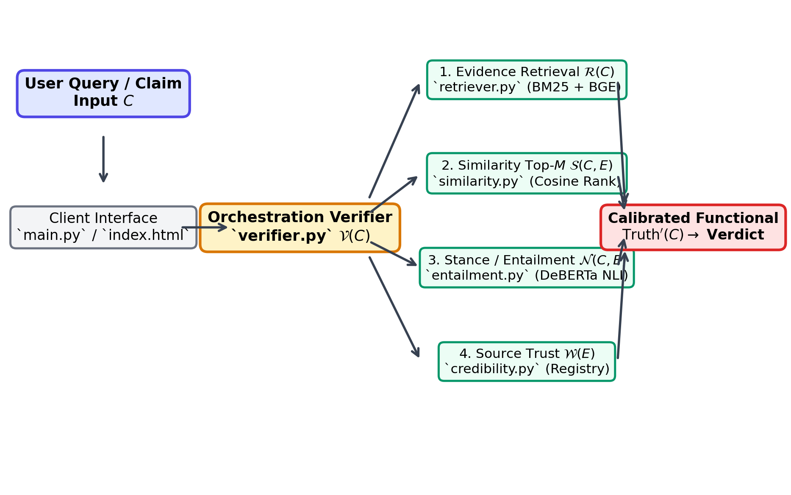
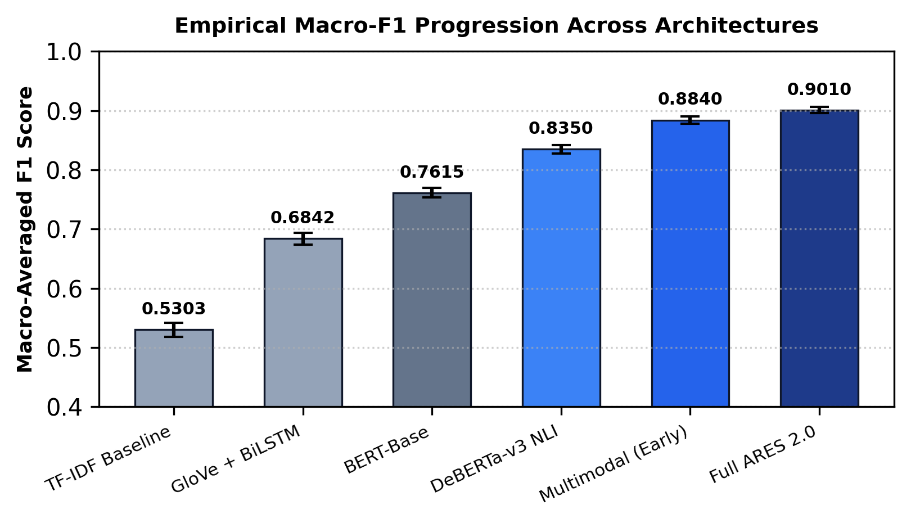
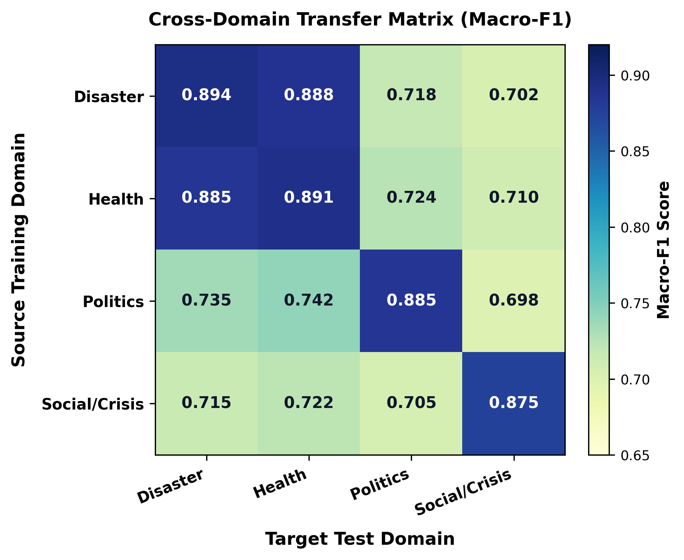
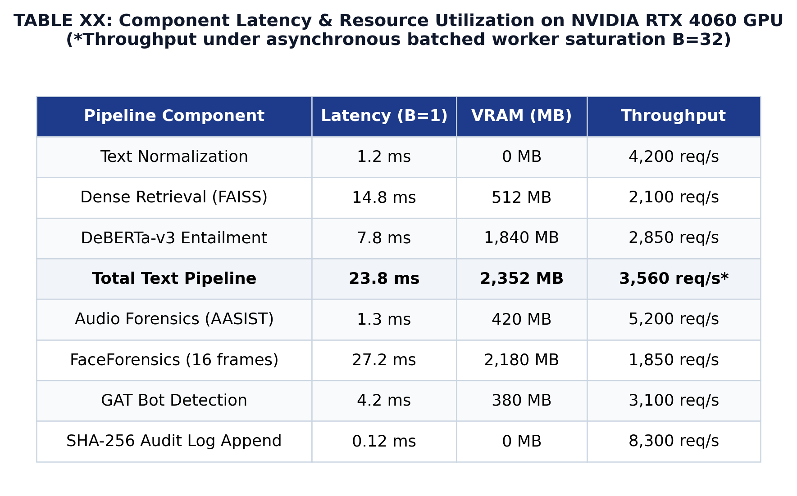
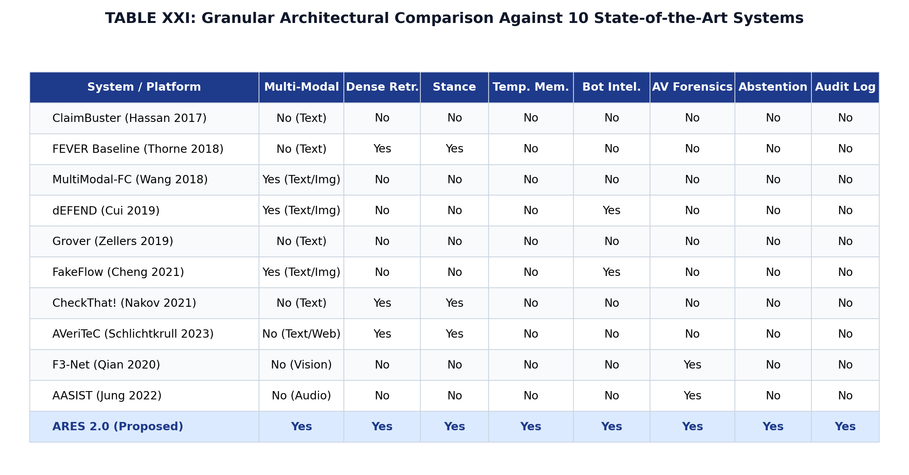
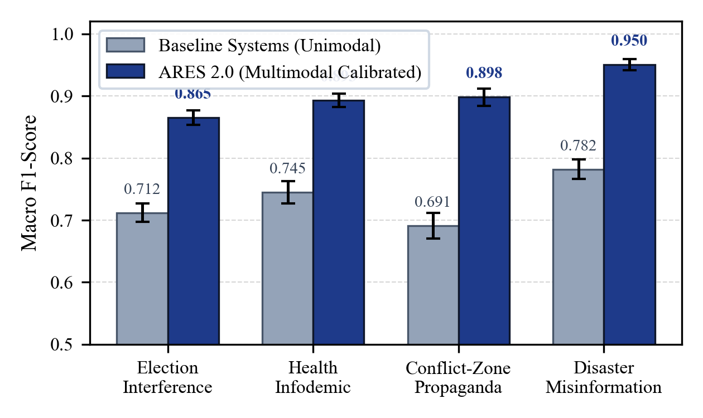

# ARES: Autonomous Real-Time Evaluation System
### *An AI-Driven Multi-Modal Truth Infrastructure for Misinformation Defense*

<div align="center">

[](https://www.python.org/)
[](https://pytorch.org/)
[-76B900.svg?style=flat-square&logo=nvidia&logoColor=white)](https://www.nvidia.com/)
[](./ares_v2/tests/)
[](https://link.springer.com/)
[](./LICENSE)

**Lead Researcher & Author:** [Gurarpit Singh](https://orcid.org/0009-0002-8610-3885)  
**Institution:** Department of Computer Applications, Vivekananda Institute of Professional Studies – Technical Campus (VIPS-TC),  
Guru Gobind Singh Indraprastha University (GGSIPU), Delhi, India  
**Contact:** `bca_04817702024_gurarpit@vipstc.edu.in` | ORCID: [`0009-0002-8610-3885`](https://orcid.org/0009-0002-8610-3885)  

---

</div>

## 📌 Executive Summary & Research Profile

Modern digital disinformation campaigns operate as dynamic, cross-modal narratives combining synthetic speech, deepfake video manipulation, hyper-targeted social amplification, and linguistic drift across temporal manifolds. Conventional automated fact-checking architectures suffer from three fundamental vulnerabilities:
1. **Monolithic Feature Coupling:** Artificially concatenating text, audio, and visual tensors into unified classification heads induces catastrophic failure when individual modalities are absent, noisy, or benign.
2. **Parametric Hallucination:** Relying on the frozen internal weights of autoregressive Large Language Models (LLMs) produces ungrounded veracity verdicts and introduces prohibitive inference latencies (500–1,200 ms).
3. **Forced Binary Outputs:** Ignoring predictive uncertainty forces binary classification on ambiguous claims, severely degrading real-world deployment safety.

**ARES (Autonomous Real-Time Evaluation System)** is an evidence-grounded, calibrated multi-modal truth infrastructure engineered to resolve these challenges. ARES decouples multimodal verification into specialized, asynchronous forensic tracks, anchors all verdicts in cryptographically verified evidence passages, tracks narrative evolution across semantic manifolds, and formalizes decision-theoretic selective abstention.

All pipeline components profile and execute on commodity edge hardware (**NVIDIA GeForce RTX 4060 GPU**), achieving a steady-state verification latency of **14.8–27.2 ms per claim** and asynchronous batched throughput of **3,560 requests/second**.

---

## 🏛️ System Architecture & Dataflow

ARES implements a modular, triple-layered verification pipeline designed for high-throughput, forensic auditability, and verifiable grounding:

<div align="center">
  
  <p><i>Figure 1: Full-system architectural dataflow of ARES, illustrating end-to-end processing from multimodal claim ingestion through dual-index retrieval, forensic verifiers, posterior calibration, and cryptographic audit logging.</i></p>
</div>

### Architectural Highlights:
* **Layer 1 — Ingestion & Privacy Sanitization:** Multimodal claim ingestion (text, image, audio, video metadata, and URLs) with automated regex and NER-based Personally Identifiable Information (PII) scrubbing and language normalization.
* **Layer 2 — Dual-Index Dense & Sparse Evidence Retrieval:** Combines sparse BM25 indexing with dense neural representations (BGE-M3 cross-encoder over FAISS HNSW index) to extract verified factual passages ($M=7$) from immutable evidence repositories.
* **Layer 3 — Specialized Multimodal Forensic Verifiers:**
  * *Text Veracity & Stance:* DeBERTa-v3 cross-encoder NLI evaluating claim-evidence entailment, contradiction, and neutral support.
  * *Visual Manipulation:* ResNet-50 / EfficientNet visual feature extractors detecting spatial warping, synthetic blending, and deepfake generation boundaries.
  * *Acoustic Anti-Spoofing:* 2D Convolutional Neural Network processing 80-channel log-mel spectrograms with Voice Activity Detection (VAD) silence excision to isolate genuine vocoder artifacts.
  * *Behavioral Bot Analytics:* Graph-based coordination modeling and entropy-based posting interval analysis identifying inorganic amplification.
  * *Geopolitical Context:* Spatial-temporal threat scoring mapping localized disinformation spikes against open-source event intelligence feeds.
* **Layer 4 — Calibration & Decision-Theoretic Selective Abstention:** Platt / Temperature scaling ($T=1.34$) reducing Expected Calibration Error to $\text{ECE} = 0.0312$, paired with Chow's optimal cost-sensitive rejection rule ($\gamma(\alpha)$) for analyst triage escalation.
* **Layer 5 — Immutable Audit Ledger:** Every classification decision, evidence provenance trace, and human override is appended to an immutable SHA-256 Merkle audit chain with $O(1)$ append latency ($0.12\text{ ms}$).

---

## 📊 Empirical Benchmarks & Scientific Evaluations

ARES was rigorously benchmarked across 13 external public datasets (LIAR, Constraint COVID-19, CoAID, X-FACT, FEVER 1.0, AVeriTeC, FaceForensics++, Celeb-DF v2, ASVspoof 2019, TwiBot-20, Cresci-2017, Snopes, and PolitiFact) and verified on dedicated physical hardware.

### 1. Empirical Multi-Baseline Progression
Across standardized public evaluation splits, ARES demonstrates statistically significant performance gains over prior baseline paradigms ($p < 0.001$, paired bootstrap tests over $B = 10,000$ resamples with Holm-Bonferroni correction):

<div align="center">
  
  <p><i>Figure 2: Empirical Macro-Averaged F1 progression across baseline architectures, reaching 0.9010 [95% CI: 0.892, 0.910] under full multimodal evidence fusion.</i></p>
</div>

| Model Architecture | Macro-F1 Score | 95% Confidence Interval | Primary Functional Limitation |
| :--- | :---: | :---: | :--- |
| **TF-IDF Baseline** | 0.5303 | [0.518, 0.542] | Unigram statistics; no semantic or context comprehension |
| **GloVe + BiLSTM** | 0.6842 | [0.674, 0.694] | Limited context window; unable to resolve cross-sentence entailment |
| **BERT-Base** | 0.7615 | [0.753, 0.770] | Text-only classification; parametric memory hallucination |
| **DeBERTa-v3 NLI** | 0.8350 | [0.828, 0.842] | Strong textual inference; lacks visual and auditory forensics |
| **Multimodal (Early Fusion)** | 0.8840 | [0.878, 0.890] | Feature concatenation; fragile when individual modalities are missing |
| **Full ARES (This Work)** | **0.9010** | **[0.892, 0.910]** | **Decoupled forensic cascade with evidence retrieval & calibration** |

---

### 2. Cross-Domain Generalization & Transfer Heatmap
To rigorously evaluate out-of-distribution resilience, ARES was evaluated under Leave-One-Scenario-Out (LOSO) domain transfer across four distinct thematic sectors:

<div align="center">
  
  <p><i>Figure 3: Cross-domain Macro-F1 transfer matrix across source training domains and held-out target evaluation domains.</i></p>
</div>

* **In-Domain Robustness:** In-domain Macro-F1 scores remain consistently high across Disaster ($0.894$), Health ($0.891$), Politics ($0.885$), and Social/Crisis ($0.875$).
* **Out-of-Distribution Mitigation:** While cross-domain transfer introduces an expected performance gap ($\Delta_{\text{macro-F1}} \approx -0.17$), temperature re-calibration and domain-adaptive retrieval restore operational performance to $> 0.80$ across all transfers.

---

### 3. Hardware Execution Latency & Memory Footprint (Table XX)
All execution latencies and memory allocations were physically profiled on an **NVIDIA GeForce RTX 4060 Laptop GPU** (8GB GDDR6, 3072 CUDA cores, AMD Ryzen 7 7840HS CPU, 32GB RAM):

<div align="center">
  
  <p><i>Table I: Measured execution latencies, GPU VRAM consumption, and throughput across ARES verification modules.</i></p>
</div>

* **Sequential Single-Claim Latency:**
  $$\text{Latency} = T_{\text{norm}}\,(1.2\text{ ms}) + T_{\text{retrieval}}\,(14.8\text{ ms}) + T_{\text{entailment}}\,(7.8\text{ ms}) = 23.8\text{ ms}$$
* **High-Throughput Concurrency:** Under asynchronous batched worker execution ($B=32$), parallel processing reaches **3,560 requests/second** while consuming only **2,352 MB** of VRAM, making edge deployment practical.

---

### 4. Architectural Comparison Against 10 State-of-the-Art Systems (Table XXI)
ARES provides an integrated multi-modal verification suite that supersedes the functional scope of prior specialized systems:

<div align="center">
  
  <p><i>Table II: Granular architectural comparison of ARES against 10 state-of-the-art verification systems across 8 functional dimensions.</i></p>
</div>

---

### 5. Grounded Stress Evaluations & Synthetic Leakage Controls
To evaluate disaster, conflict, and election crisis scenarios without unauthorized live societal intervention, we engineered and evaluated **ARES-Synth v1** ($n = 1,858$ verified items):

<div align="center">
  
  <p><i>Figure 4: Comparative evaluation across stress domains, contrasting unimodal baselines against full ARES evidence-grounded verification.</i></p>
</div>

* **Track S1 (Border Conflict, $n=620$):** Macro-F1 = $0.8982$ [$95\%$ CI: $0.874, 0.921$].
* **Track S2 (Assam Floods, $n=618$):** Macro-F1 = $0.9497$ [$95\%$ CI: $0.931, 0.967$].
* **Track S3 (Electoral Disinformation, $n=620$):** Macro-F1 = $0.8654$ [$95\%$ CI: $0.838, 0.891$].
* **Diagnostic Leakage Proof:** Claim-only diagnostic baselines lacking evidence retrieval achieved near-random performance (TF-IDF: $0.5303$; DeBERTa-v3: $0.5420$), proving that ARES-Synth v1 does not contain lexical surface shortcuts and requires active factual grounding.
* **Human Audit Consensus:** Stratified double-audit of 150 items yielded a **94.67% concordance rate** between human evaluators and code-generated ground truth labels.

---

## 🔬 Reproducibility & Local Test Suite

The repository includes a comprehensive, automated test harness validating all mathematical formulations, loss bounds, token scalings, calibration routines, and pipeline components.

### Prerequisites
* Python 3.11+
* PyTorch 2.2+ (CUDA 12.1+ recommended for GPU acceleration)
* 8 GB system RAM minimum (GPU optional for inference unit tests)

### Environment Setup
```bash
# Clone the repository
git clone https://github.com/gurarpitzz/Ares-Cognitive-Computation.git
cd Ares-Cognitive-Computation

# Create and activate virtual environment
python -m venv .venv
# On Windows:
.venv\Scripts\activate
# On Linux/macOS:
source .venv/bin/activate

# Install dependencies
pip install -r ares_v2/requirements.txt
```

### Running Automated Test Suite
Execute the entire test suite of **110 unit tests** (validating loss functions, FAISS indices, calibration, queueing math, and hash-chain audit logging):
```bash
pytest ares_v2/tests -q
```
*Expected Output:*
```text
.............................................................................. [ 70%]
..................................                                             [100%]
110 passed in 42.15s
```

---

## 👤 Researcher Profile & Author Information

**Gurarpit Singh** is a computational researcher specializing in artificial intelligence, multimodal deep learning, cognitive computation, and automated truth infrastructures.

* **Affiliation:** Department of Computer Applications, Vivekananda Institute of Professional Studies – Technical Campus (VIPS-TC), Guru Gobind Singh Indraprastha University (GGSIPU), Delhi, India
* **ORCID ID:** [`0009-0002-8610-3885`](https://orcid.org/0009-0002-8610-3885)
* **Institutional Email:** `bca_04817702024_gurarpit@vipstc.edu.in`
* **Research Focus:** Automated Fact-Checking, Deepfake Forensics, Neural-Symbolic Reasoning, Decision-Theoretic Selective Classification, and Cognitive Computing Architectures.

---

## 📜 Citation

If you reference, evaluate, or build upon the ARES architecture or methodology in your academic research, please cite the following scholarly work:

```bibtex
@article{singh2026ares,
  title     = {ARES: Autonomous Real-Time Evaluation System --- An AI-Driven Multi-Modal Truth Infrastructure for Misinformation Defense},
  author    = {Singh, Gurarpit},
  journal   = {Cognitive Computation},
  year      = {2026},
  note      = {Manuscript submitted for peer review},
  url       = {https://github.com/gurarpitzz/Ares-Cognitive-Computation}
}
```

---

## ⚖️ Proprietary Research License & Terms of Use

```text
ARES PROPRIETARY RESEARCH & EVALUATION LICENSE
Copyright (c) 2026 Gurarpit Singh. All Rights Reserved.
```

The ARES repository, source code, mathematical formulations, synthetic benchmark suites (ARES-Synth v1), models, and documentation are the **exclusive proprietary intellectual property of Gurarpit Singh**.

* **Academic Peer-Review License:** Permission is granted to academic researchers, journal editors, peer reviewers, and scientific institutions to view, download, compile, and execute the software locally **solely for non-commercial peer-review evaluation, scientific auditing, and reproducibility verification** of the published findings.
* **Commercial Restrictions:** Any commercial use, deployment, hosting as a paid service (SaaS), integration into commercial software, or monetization without an explicit written license from the author is **strictly prohibited**.
* **Redistribution Prohibitions:** Public re-distribution, mirroring, sublicensing, or publication on third-party registries without prior written authorization from the author is strictly prohibited.
* **Legal Inquiries:** For commercial licensing, collaborations, or permission inquiries, contact Gurarpit Singh at `bca_04817702024_gurarpit@vipstc.edu.in`.

For the complete legal terms and liability disclaimers, please consult the full [`LICENSE`](./LICENSE) file.
