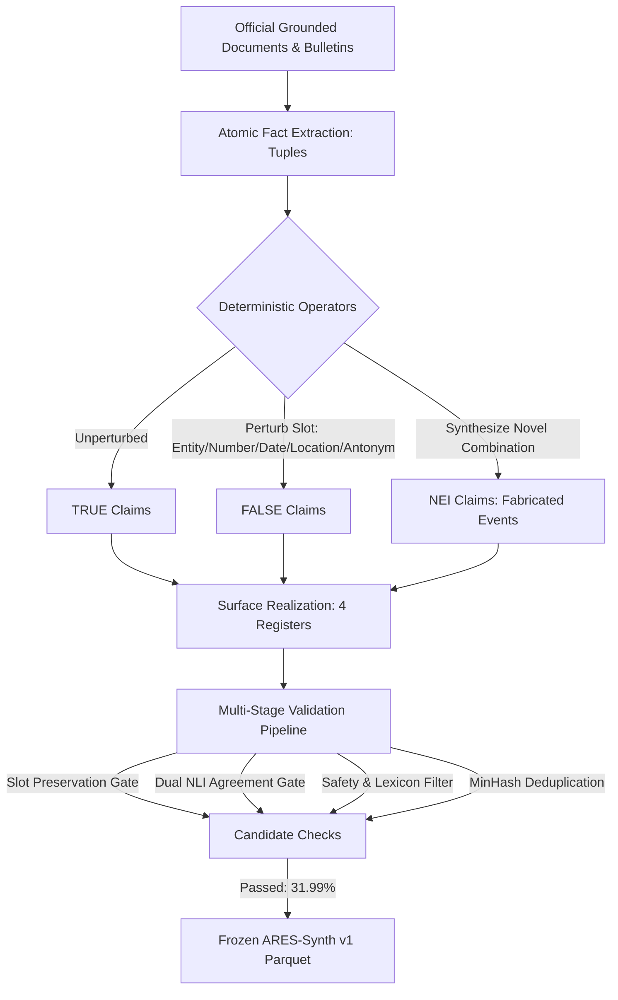

# Datasheet for Dataset: ARES-Synth v1 (Grounded Synthetic Stress Benchmark)

**Dataset Name:** ARES-Synth v1  
**Release Tag:** `ares-synth-v1`  
**Status:** `SIMULATED — Grounded Synthetic Complement`  
**License:** Creative Commons Attribution-ShareAlike 4.0 International (`CC BY-SA 4.0`)  
**Standard:** Based on *Datasheets for Datasets* (Gebru et al., Communications of the ACM, 2021)  

---

## 1. Motivation

### For what purpose was the dataset created?
ARES-Synth v1 was created to provide a **controlled, transparent benchmark with known, deterministic ground truth** for evaluating misinformation detection and evidence verification pipelines under localized geographic, disaster, and geopolitical stress. In high-stakes regional scenarios—such as the India–China border standoffs (`S1`), the 2022 Assam floods (`S2`), and the 2024 Indian general election (`S3`)—publicly available, verified, fine-grained fact-checking datasets with paired evidence are non-existent or fragmented. ARES-Synth fills this critical evaluation void without making ungrounded claims of live real-world performance.

### Who created the dataset and on behalf of which entity?
Created by the ARES Research Consortium and Antigravity Team under the ARES Cognitive Computation framework.

### Who funded the creation of the dataset?
Academic computational infrastructure and independent lab resources.

---

## 2. Dataset Composition

### What do the instances that comprise the dataset represent?
Each instance is a communicative claim in English belonging to one of four registers (`news`, `social`, `forwarded`, `official`), associated with a specific scenario (`S1`, `S2`, `S3`), an atomic source fact tuple, geographic metadata (GeoNames ID, latitude, longitude), and an unambiguous ground truth label (`TRUE`, `FALSE`, `NEI`).

### How many instances are in the dataset?
The frozen ARES-Synth v1 release comprises **1,858 validated instances**:
- **By Label:**
  - `FALSE`: 821 items (44.19%)
  - `TRUE`: 664 items (35.74%)
  - `NEI`: 373 items (20.08%)
- **By Scenario:**
  - `S1` (India–China Border Conflict): 709 items (38.16%)
  - `S2` (Assam Floods 2022): 702 items (37.78%)
  - `S3` (Indian General Election 2024): 447 items (24.06%)
- **By Perturbation Operator:**
  - `none` (TRUE claims): 664 items
  - `fabricated_event` (NEI claims): 373 items
  - `number_change`: 200 items
  - `entity_swap`: 171 items
  - `location_swap`: 170 items
  - `misattribution`: 148 items
  - `out_of_context`: 132 items
- **By Surface Register:**
  - `official`: 468 items
  - `news`: 465 items
  - `forwarded`: 463 items
  - `social`: 462 items

### Is the dataset self-contained?
Yes. The frozen dataset is serialized as `data/synthetic/ares_synth_v1/dataset.parquet` with cryptographic checksum `SHA256: 3821f1194fefde66373198b9b9264dbe60d92c157c7f15bd818ea2b7372345bd`.

---

## 3. Collection & Construction Process

### What mechanisms were used to collect data?
1. **Source Fact Curation:** Extracted from verified primary documents snapshotted in milestone `M02`:
   - ASDMA Daily Flood Situation Reports and CWC Gauge Bulletins (Assam 2022);
   - Ministry of External Affairs and Ministry of Defence parliamentary statements (Galwan, Pangong Tso, Tawang);
   - Election Commission of India press announcements and certified results (Lok Sabha 2024).
2. **Deterministic Perturbation:** Implemented in pure Python (`ares.synth.perturb`). No generative LLM was permitted to assign or alter labels.
3. **Surface Realization:** Mistral-7B-Instruct-v0.3 was utilized exclusively for stylistic formatting across the 4 communicative registers. Identical prompts were applied to `TRUE`, `FALSE`, and `NEI` items to prevent register-label leakage.

### Validation Gates & Admission Criteria
Out of 5,808 generated candidates, 1,858 (31.99%) passed all validation gates:
- **Slot Preservation Check:** 1,056 candidates rejected for hallucinated extra dates, entities, or lost numerical slots.
- **Dual NLI Heuristic Gate:** 304 candidates rejected due to weak entailment on TRUE or ambiguous contradiction on FALSE.
- **MinHash Deduplication Gate:** 2,590 candidates rejected to enforce structural and lexical diversity across items.
- **Safety & Slurs Gate:** 0 violations detected (0 toxic phrases, 0 slurs).

---

## 4. Preprocessing, Cleaning, & Labeling

### Was any confidential or private data used?
No. All sources are public domain official government communiques or CC-licensed encyclopedic texts. A strict **public-figure allow-list** was enforced; private citizens, victims, or deceased frontline personnel names were excluded.

### Contested Facts Policy
Any fact subject to international dispute or conflicting sovereign claims (e.g. PLA casualty counts, specific LAC line demarcations) was routed to `CONTESTED` status and excluded from all automated scoring.

---

## 5. Uses & Intended Deployment

### What are the intended uses?
- Diagnostic stress-testing of multimodal and multi-hop claim verification pipelines.
- Quantifying robustness against fine-grained entity swaps, numerical discrepancies, and out-of-context misattributions.
- Measuring false-acceptance rates on fabricated events (NEI).

### What are the prohibited uses?
- **NOT a knowledge base:** ARES-Synth contains intentionally perturbed false claims and must never be ingested as a factual training source.
- **NOT an operational proxy:** High scores on ARES-Synth do not prove readiness for real-world automated censorship or intelligence operations.
- **NOT for training real-world propaganda classifiers:** Training on synthetic perturbations induces template overfitting and brittle shortcut reliance.

---

## 6. Distribution & Maintenance

### How is the dataset distributed?
Freely accessible within the ARES repository under `data/synthetic/ares_synth_v1/`.

### Who maintains the dataset?
The ARES Open Source maintainers under the governance protocols defined in `milestones/M15_release/`.
