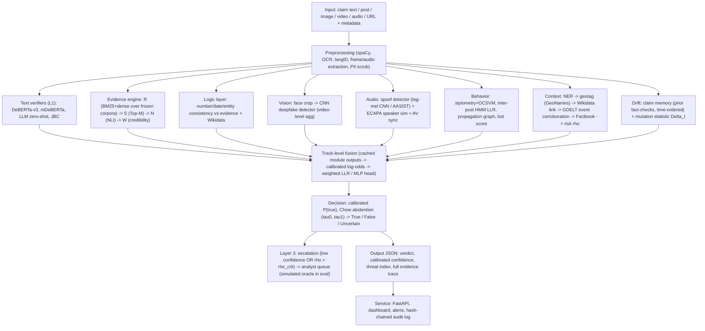
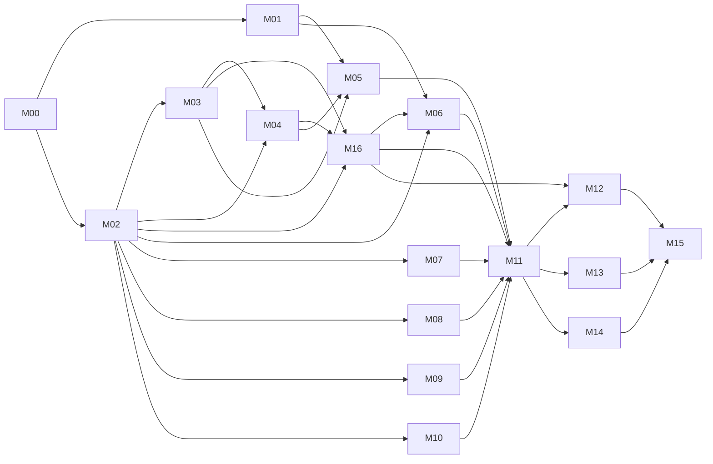

# ARES Rebuild — Master Implementation Plan

> Read `01_MANUSCRIPT_AUDIT.md` and `02_GEMINI_PROTOCOL.md` first. This file is the map; each milestone has its own detailed file in `plan/milestones/`.

## 1. Goal

Rebuild ARES as a real, reproducible, open-source system that implements the architecture in the manuscript, evaluated on public benchmarks with pre-registered, statistically sound protocols. The result is a code + models + results package that lets **every surviving claim in the paper be traced to a script, a commit, a dataset manifest, and a results JSON**. Claims that can't be grounded are corrected or removed.

**Deliverables at the end:**
1. `ares_v2/`: public GitHub repo (new; `ARES_POC` gets archived/redirected), tagged release, Zenodo DOI.
2. Trained model weights on Hugging Face Hub (where dataset licences allow), with model cards.
3. `milestones/M00…M16/`: full evidence trail (prereg, code, results, figures, tables, audits).
4. `plan/claims_ledger.csv`: every manuscript claim with final status and measured value.
5. `milestones/M15_release/manuscript_reconciliation.md`: section-by-section rewrite instructions for the paper, generated from the ledger, plus all regenerated figures/tables (vector PDF + LaTeX).

## 2. System architecture to build (ARES v2)

This follows the manuscript's architecture (Figs. 2, 4, 9, 18, 33, 43; App. A), with each module made concrete and testable.

**Key design decision (forced by the data):** no public dataset contains every modality for the same items. ARES v2 is therefore evaluated as a **multi-track benchmark ("ARES-Bench")**. In each track, the modules whose inputs exist are active. The full-system claim becomes "ARES-Bench results across tracks", and the ablations are run per track where they make sense. The fusion layer is the same code everywhere. Only the set of active modules changes.

## 3. ARES-Bench tracks

| Track | Task | Datasets | Active modules | Primary metric |
|---|---|---|---|---|
| **T1 Text veracity** | Claim → T/F (and 6-way for LIAR) | LIAR, Constraint-COVID, CoAID (claims/news), X-FACT (multilingual) | Text, Logic (where evidence), Drift-memory, Geo | Macro-F1 |
| **T2 Evidence-based verification** | Claim + retrieved evidence → S/R/NEI | FEVER 1.0 (wiki dump), AVeriTeC (knowledge store) | Evidence (R·S·N·W), Logic, Text, Drift-memory, Geo (GDELT event corroboration) | FEVER: label acc + FEVER score; AVeriTeC: official score + macro-F1 |
| **T3 Image–text misinformation** | Post (text+image) → T/F | Fakeddit (2-way, 6-way); optional NewsCLIPpings | Text, Vision (JBC), Metadata | Macro-F1 |
| **T4 Video deepfake** | Video → real/fake | FaceForensics++ c23 (in-domain), Celeb-DF v2 (cross) | Vision | Video-level AUC; also TPR@FPR=1%, F1 |
| **T5 Audio spoof / voice** | Utterance → bona fide/spoof; speaker same/different | ASVspoof 2019 LA (+2021 LA/DF, In-the-Wild cross); VoxCeleb1-O | Audio | EER, min t-DCF; speaker EER |
| **T6 Audio-visual** (optional, access) | Video+audio → real/fake | FakeAVCeleb | Vision, Audio, AV-sync | AUC, macro-F1 |
| **T7 Social propagation** | Rumour/news + propagation → T/F | PHEME (leave-one-event-out), UPFD-PolitiFact/GossipCop | Text, Behavior, Temporal, Geo | Macro-F1 |
| **T8 Bot detection** | Account → bot/human | TwiBot-20 (or 22), Cresci-2017 | Behavior | F1, AUC |
| **T9 Claim mutation / matching** | Claim pair → same narrative / mutated; retrieve prior fact-check | PAWS, MultiClaim, CheckThat! 2021–22 Task 2, STS-B | Drift | ROC-AUC, MAP@5 |
| **T10 Stress / shift** | Train-on-others → test scenario | Health (COVID, CoAID, PUBHEALTH, HealthVer), Politics (LIAR, PolitiFact), Science/Climate (SciFact, CLIMATE-FEVER), Indian news (IFND, FactDrill), Elections (subset) | All available | Macro-F1, Δ vs in-domain |
| **T11 Temporal external validation** | Claims fact-checked **after model freeze** | Google Fact Check Tools / ClaimReview, collected post-freeze | Full T2 pipeline | Macro-F1, agreement |
| **T12 ARES-Synth (grounded synthetic stress)** | Claim (+ snapshot evidence corpus) → T/F/NEI; mutation chains with known change points | S1 India–China border (Galwan 2020, Yangtse 2022), S2 Assam floods 2022, S3 (optional) Indian general election 2024 — built in **M16**, test-only, always labelled **SIMULATED** | Full T2 pipeline, Logic, Geo, Drift | Macro-F1 per perturbation type, ECE, abstention coverage; drift: detection delay / FPR |

## 4. Dataset registry (acquire in M02; submit every request form on day 1 of M00)

**Data policy (proof of concept):** use **all relevant public data**, including academic datasets behind a request/licence form. Rigour is not relaxed: every dataset gets a manifest (source URL, version, licence, SHA256, split sizes), a leakage audit, and a datasheet entry. Where a licence forbids redistribution, we release IDs/hashes + scripts only.

**Tiers.** **Tier 1** = core; needed to test a ledger claim; must be done. **Tier 2** = extended generalisation ("all public data"); every Tier-2 set that is acquired is evaluated under the same frozen protocol and reported, including bad results. Tier-2 sets are processed **one at a time** (download → features/predictions → delete raw) so they fit the storage budget in §5.4. If one is skipped, the reason goes in `M02/README.md`; never skip quietly. Sizes are estimates (**verify** in M02.1).

| Tier | Dataset | Track | Access | Est. raw size | Notes / pitfalls |
|---|---|---|---|---|---|
| 1 | LIAR | T1 | Open | <0.1 GB | Verify split sizes 10,269 / 1,284 / 1,283. **Never use PolitiFact justifications (LIAR-PLUS) as evidence**: that's label leakage |
| 1 | FEVER 1.0 + wiki-pages (2017) | T2 | Open (fever.ai) | ~2 GB raw; ~10–15 GB indexes | Use official splits; shared-task test labels may be hidden. Use paper-dev as test if needed and say so |
| 1 | AVeriTeC | T2 | Open | knowledge store: tens of GB (**verify**) | Download the dev/test knowledge stores only; leakage-controlled retrieval |
| 1 | Constraint@AAAI-2021 COVID fake news (English) | T1 | Open | <0.1 GB | Social posts |
| 1 | CoAID | T1/T10 | Open (GitHub) | <0.5 GB | Health misinformation; news + claims |
| 1 | X-FACT | T1 | Open | <0.5 GB | 25 languages (manuscript said 14) |
| 1 | PHEME (9 events) | T7 | Open (figshare) | ~1 GB | Use leave-one-event-out to avoid event leakage |
| 1 | UPFD (PolitiFact/GossipCop graphs) | T7 | Open (`torch_geometric.datasets.UPFD`) | ~1 GB | Propagation graphs with user features |
| 1 | FakeNewsNet | T1/T10 | Partially open | <1 GB (content only) | Social context needs Twitter hydration (API effectively unavailable). Use news content only, or UPFD |
| 1 | Fakeddit | T3 | Open | subset images ~10–15 GB | Use a fixed, stratified, seeded **subset of ~60k/6k/6k** (full image set does not fit). Image URLs decay: hash images, release IDs |
| 1 | FaceForensics++ c23 | T4 | **Request form** | ~10–20 GB c23 (**verify**) | DeepFakes, Face2Face, FaceSwap, NeuralTextures (+FaceShifter). Split by official JSON (identity-disjoint). Delete raw videos once face crops are verified and hashed |
| 1 | Celeb-DF v2 | T4 | **Request form** | ~10 GB | Cross-dataset **test list only** (518 videos). Delete non-test videos after extraction |
| 1 | ASVspoof 2019 LA | T5 | Open (Edinburgh DataShare) | ~8 GB | Official train/dev/eval; eval attacks A07–A19 unseen |
| 1 | ASVspoof 2021 LA eval, In-the-Wild | T5 | Open | ~8 GB each | Cross-dataset robustness |
| 1 | VoxCeleb1 (**test set only**) | T5 | **Request/credentials** | ~1 GB | VoxCeleb1-O trials with a pretrained ECAPA. No VoxCeleb training, so the dev set isn't needed |
| 1 | TwiBot-20 | T8 | **Request** | ~5–10 GB (**verify**) | Stream the JSON (`ijson`); never load it whole into 16 GB RAM |
| 1 | Cresci-2017 | T8 | Open (bot repository) | <1 GB | Small, classic |
| 1 | PAWS, STS-B | T9 | Open | <0.1 GB | H0/H1 pairs; Lipschitz estimation |
| 1 | MultiClaim | T9 | Request (Zenodo terms) | ~1 GB | Multilingual claim matching |
| 1 | CheckThat! 2021/2022 Task 2 | T9 | Open | <0.5 GB | Previously fact-checked claim retrieval |
| 1 | ClaimBuster dataset | T1 | Open | <0.1 GB | Check-worthiness ("claim extraction" layer, Tab. XV) |
| 1 | LLMFake (Chen & Shu, ICLR 2024) | T12/M12 | Open | <0.1 GB | LLM-generated misinformation robustness |
| 1 | Lin et al. 2023 domain-quality ratings (PNAS Nexus) | T2 | Open | <0.1 GB | Source credibility prior W(E) |
| 1 | GeoNames, Wikidata, GDELT 2.0, World Factbook (archived JSON) | Geo | Open | ~2–5 GB snapshots | **Snapshot** every query response with timestamp |
| 1 | Google Fact Check Tools API | T11 | Free API key | <0.1 GB | T11 post-freeze collection |
| 1 | Wikipedia revisions, ReliefWeb, ASDMA reports, PIB/MEA/China MFA statements | T12 | Open | <1 GB | **Source documents for ARES-Synth (M16)**, snapshotted at fixed revision IDs/dates |
| 2 | MultiFC | T1/T10 | Open (research) | <1 GB | 26 fact-check sites; heterogeneous label sets → map to T/F/drop, mapping pre-registered |
| 2 | Snopes corpus (UKP) | T2 | Open (request) | <1 GB | Claim + evidence sentences |
| 2 | CLIMATE-FEVER, SciFact | T2/T10 | Open | <1 GB | Domain shift for evidence engine |
| 2 | PUBHEALTH, HealthVer, COVID-Fact | T1/T2/T10 | Open | <1 GB | Health shift. **PUBHEALTH explanations = label leakage; never use as evidence** |
| 2 | Twitter15/16, RumourEval 2019 | T7 | Open | <1 GB | Tweet IDs + trees; many tweets are gone → report coverage |
| 2 | WELFake, ISOT | T1/T10 | Open | <1 GB | **ISOT has a known source shortcut** (Reuters vs non-Reuters style, "(Reuters)" token). Strip the shortcut tokens and report a claim-only shortcut baseline next to every result |
| 2 | IFND (Indian Fake News Dataset), FactDrill | T1/T10 | Open (request) | <2 GB | Indian / Indian-regional-language misinformation; directly relevant to the India context of the paper |
| 2 | Constraint@AAAI-2021 Hindi hostile posts | T1/T10 | Open | <0.1 GB | Hindi; fake-news label only |
| 2 | MOCHEG, Factify 2, VERITE, NewsCLIPpings | T3 | Open / request | ~5–20 GB each (**verify**) | Image–text; process one at a time; VERITE is built to defeat unimodal shortcuts — report it as the hard test |
| 2 | DFDC preview, WildDeepfake, DeeperForensics-1.0 (subset) | T4 | Request | ~10–20 GB each for the subsets used (**verify**) | Cross-dataset video tests only. Full DFDC (~470 GB) is **out of scope on storage**; say so |
| 2 | ASVspoof 2021 DF eval (subset), WaveFake (subset), Fake-or-Real (FoR) | T5 | Open | ~10 GB per subset used | Seeded, stratified subsets (by vocoder/attack); subset IDs released |
| 2 | FakeAVCeleb | T6 | **Request form** | ~10–20 GB | Optional T6 |
| 2 | Cresci-2015, Botometer bot repository sets (varol-2017, gilani-2017, midterm-2018, …) | T8 | Open | <2 GB | Cross-dataset bot detection |
| 2 | TwiBot-22 | T8 | Request | very large (**verify**) | Only a documented subgraph, if any; otherwise state "excluded on storage grounds" |

## 5. Compute plan — one workstation, no cloud

All execution happens on the user's laptop (repo root: `laptop_spec_sheet.md`). The Mac is only used to read and edit the plan; **no milestone step runs on it.** There is no cloud budget.

| Component | Spec | Consequence for the plan |
|---|---|---|
| GPU | NVIDIA GeForce RTX 4060 Laptop, **8 GB** GDDR6, Ada (bf16, 4th-gen Tensor cores) | bf16 + gradient accumulation + gradient checkpointing; 7–8B LLMs only at 4-bit; one GPU job at a time |
| CPU | i7-13620H, 10 cores / 16 threads | BM25 indexing, FAISS (CPU), Monte Carlo, data prep run on CPU in parallel with GPU jobs |
| RAM | **16 GB** DDR5 | WSL gets ~12 GB; stream large JSON; memory-mapped Arrow/parquet; no full-corpus in-RAM indexes |
| Disk | 1 TB NVMe: C: 37.5 GB free · **D: 188.5 GB free** · E: 88.3 GB free | Everything lives on D:; peak budget ≤ 150 GB; E: is the backup target; raw data deleted after verified feature extraction |
| OS | Windows 11 Home 24H2 (WSL2/Hyper-V available) | Linux toolchain via WSL2 Ubuntu 24.04 |
| Power | 83 Wh battery at 82.7 % health | Never train on battery; long jobs only on AC |

### 5.1 Environment (set up in M00.9)
- **WSL2 + Ubuntu 24.04.** Install only the NVIDIA **Windows** driver; never install a Linux NVIDIA driver inside WSL. CUDA comes from the PyTorch cu12x wheels.
- **Move the distro to D:** (`wsl --export` → `wsl --import Ubuntu-ARES D:\wsl\ares …`). C: has too little free space.
- `%UserProfile%\.wslconfig`: `memory=12GB`, `processors=14`, `swap=16GB`, `swapFile=D:\\wsl\\swap.vhdx`.
- `<ARES_ROOT>` = `~/ares` **inside the WSL ext4 filesystem** (which lives on D:). Do not work from `/mnt/d/...`: the 9P bridge is several times slower for many small files.
- All caches go under `<ARES_ROOT>/cache`: `HF_HOME`, `TORCH_HOME`, `PIP_CACHE_DIR`, `UV_CACHE_DIR`, conda pkgs.
- Java 21 for Pyserini.
- Containers (M14/M15): Docker Engine inside WSL, or Docker Desktop with the WSL2 backend if its licence terms fit the user.

### 5.2 Fitting the work into 8 GB VRAM and 16 GB RAM
| Workload | Tactic (record every choice in the results JSON `config`) |
|---|---|
| Base encoders (BERT/RoBERTa/DeBERTa-v3-base, mDeBERTa) | Full fine-tune, bf16 autocast, micro-batch 8–16 + gradient accumulation to the **declared effective batch 32**; dynamic padding with length bucketing; `max_len` = data 99.5th percentile, capped at 512 |
| DeBERTa-v3-large (NLI/verifier) | bf16 + gradient checkpointing + 8-bit AdamW; micro-batch 2–4. Fit is tested in the M00 smoke test. If it doesn't fit, use LoRA and **label it LoRA**. Run as a K=3–5 *reference* model, never as a K=10 headline comparison unless budget allows |
| LLM member (7–8B instruct) | 4-bit (bitsandbytes NF4 or llama.cpp GGUF Q4_K_M, ~5–6 GB). Zero/few-shot with label-token log-probs; optional QLoRA r=16, seq ≤ 512 |
| FEVER retrieval | Pyserini BM25 (Lucene, on disk) for documents; FAISS **IVF-PQ** (CPU, mmap) for dense passages; cross-encoder reranking of sentences from the top-k docs on GPU. A full flat dense sentence index does not fit and isn't needed |
| Video deepfakes | Faces cropped once (GPU detector) → JPEG crops at the model's input size; training reads crops, never video; mixed precision; micro-batch to fit, gradient accumulation to declared batch |
| Audio | Precompute features where the model allows; train on crops of fixed length; pretrained ECAPA for speaker similarity |
| Large JSON / graphs | `ijson` streaming, parquet shards, `num_workers ≤ 6` |

### 5.3 Long-job operations
- **Power and thermals:** AC adapter connected. OMEN Gaming Hub in Performance mode. Laptop on a stand or cooling pad. Windows sleep/hibernate disabled on AC. Windows Update paused, with active hours set, during long runs.
- **Telemetry:** every GPU job logs `nvidia-smi --query-gpu=timestamp,temperature.gpu,clocks.sm,power.draw,utilization.gpu,memory.used --format=csv -l 30` to `logs/gpu_telemetry.csv`. Thermal throttling doesn't invalidate accuracy results, but any timing result taken during throttling is flagged.
- **Resumable training is mandatory:** checkpoint at most every 30 min, saving model, optimizer, scheduler, scaler, all RNG states and data-loader position. A kill-and-resume test is part of M00, and a resumed run must match an uninterrupted run within tolerance.
- **Job queue:** a file-based queue (`scripts/queue/`) or `task-spooler`, run under `tmux`. One GPU job at a time; CPU jobs can run alongside it if RAM allows.

### 5.4 Storage budget and retention
| Item | Peak estimate on D: (**verify**) |
|---|---|
| Text/social/claim datasets (Tier 1) | ~10 GB |
| FEVER wiki + BM25 + IVF-PQ indexes; AVeriTeC dev/test knowledge stores | ~30–45 GB |
| FF++ c23 raw (deleted after crops) + face crops + Celeb-DF test | ~35 GB peak, ~20 GB after deletion |
| Audio (ASVspoof 2019 LA, 2021 LA eval, In-the-Wild, VoxCeleb1 test) | ~25 GB |
| Fakeddit subset, TwiBot-20, geo snapshots | ~25 GB |
| Model cache (HF/GGUF) + kept checkpoints | ~30 GB |
| Tier-2 working slot (one dataset at a time) | ≤ 20 GB |
| **Peak target** | **≤ 150 GB** (leaves ≥ 35 GB headroom on D:) |

**Retention policy**
- For every (model, config), keep the predictions/logits of **all seeds** (they're small).
- Keep the checkpoint of the **seed-median run**, plus any checkpoint a later milestone loads.
- Delete the other checkpoints after writing their SHA256 and config to `models/deleted_checkpoints.csv`; they can be retrained from the logged seed.

**Backups**
- Nightly `rsync` of `milestones/`, `results/` and kept checkpoints to `E:\ares_backup`.
- Push code and results to a private GitHub repo, and kept models to a private HF repo.

### 5.5 GPU time (RTX 4060 Laptop hours, ±50 %, measured and re-estimated after M00's smoke test)
M02 ≈ 12 (face extraction) · M03 ≈ 80–110 · M04 ≈ 15–20 · M05 ≈ 5 · M06 ≈ 3 · M07 ≈ 60 · M08 ≈ 45 · M09 ≈ 5 · M10 ≈ 3 · M16 ≈ 6–8 · M11 ≈ 45 · M12 ≈ 50–60 · M13 ≈ 10.

**Total ≈ 350–450 GPU-h.** Running overnight and at weekends (~40–60 GPU-h/week), that is **≈ 8–14 weeks of GPU wall-clock**; CPU-side work proceeds in parallel.

**If the budget overruns, cut in this order:**
1. Tier-2 datasets.
2. DeBERTa-large seeds.
3. Optional T6.

Never reduce K below the protocol minimum (K=10) for headline comparisons, and never silently shrink a test set. Kaggle's free GPU quota is an **optional overflow for independent training jobs only**. The hardware is recorded in the results JSON, and latency is never measured there.

### 5.6 Hardware honesty rule
The manuscript says A100 (40 GB) / Xeon / 64 GB. **All latency and throughput numbers in the rebuilt paper come from this laptop** (RTX 4060 Laptop 8 GB, i7-13620H, 16 GB DDR5, WSL2), measured under the M13 thermal protocol and recorded in every results JSON. The manuscript's hardware statement is therefore REVISED (C033, C034). Throughput claims such as 4000 req/s are re-measured to saturation and will almost certainly be REVISED.

## 6. Milestones

Milestone IDs are fixed (the ledger refers to them). **Execute in the `Order` column.** M16 was added later, so its number doesn't match its position.

| Order | ID | File | Name | Depends on | Primary ledger IDs |
|---|---|---|---|---|---|
| 1 | M00 | `M00_foundation.md` | Foundation, integrity infrastructure, laptop/WSL setup, access requests | — | all (ledger), C076 |
| 2 | M01 | `M01_theory.md` | Corrected formal foundations: exact mutation theorem, LLR/abstention, complexity, shift bound | M00 | C070–C075, C077, C078 |
| 3 | M02 | `M02_data.md` | Data acquisition (Tier 1 + Tier 2), curation, splits, leakage audit | M00 | C032, C088, C089 |
| 4 | M03 | `M03_text_verifiers.md` | Text baselines & Layer-1 text verifiers | M02 | C038, C039, C050, C064, C065 |
| 5 | M04 | `M04_evidence_engine.md` | Evidence engine R·S·N·W + logic layer (ARES_POC done properly) | M02, M03 | C018, C040, C067, C078 |
| 6 | M16 | `M16_synthetic_stress_benchmarks.md` | ARES-Synth: grounded synthetic India–China border / Assam floods (/ election) benchmarks + mutation chains, validated and **frozen** | M02, M03, M04 | C020–C022, C011, C012 |
| 7 | M05 | `M05_decision_hitl.md` | Decision layer: LLR fusion, calibration, abstention, L2 voting, simulated HITL | M01, M03, M04 | C010, C061–C063, C072 |
| 8 | M06 | `M06_drift_mutation.md` | Drift & mutation: test the theory on real embeddings + M16 synthetic chains; claim memory | M01, M02, M16 | C011, C012, C070, C074, C085, C086 |
| 9–12 | M07 | `M07_vision_deepfake.md` | Visual deepfake detection | M02 | C013, C015 |
| 9–12 | M08 | `M08_audio.md` | Audio spoofing, speaker embeddings, (AV sync) | M02 | C014, C015, C088 |
| 9–12 | M09 | `M09_behavior_bots.md` | Behavioral & bot detection, propagation | M02 | C080, C081 |
| 9–12 | M10 | `M10_geo_context.md` | Geopolitical context: NER, geotag, Wikidata, GDELT, Factbook, risk | M02 | C007–C009, C083 |
| 13 | M11 | `M11_fusion_ablation.md` | Track-level fusion, full system, ablations, Shapley, significance | M03–M10, M16 (frozen; not trained on) | C001, C043, C046–C049, C051–C058, C068, C069 |
| 14 | M12 | `M12_robustness_shift.md` | Adversarial robustness, cross-domain, LOSO stress, ARES-Synth evaluation, temporal external validation | M11, M16 | C003, C019–C023, C037, C044, C045, C056, C059, C060, C066, C073 |
| 15 | M13 | `M13_systems_perf.md` | Latency, throughput, complexity, preprocessing model (RTX 4060 Laptop) | M11 | C002, C004–C006, C016, C017, C028, C029, C033–C036, C041, C042, C062, C075, C087, C094, C095 |
| 16 | M14 | `M14_service_ops.md` | Service: API, dashboard, alerts, audit log, PII, transparency | M11 | C031, C082, C084 |
| 17 | M15 | `M15_release_manuscript.md` | Release, reproducibility package, references, figures, manuscript reconciliation | all | C076, C079, C090, C092, C024–C027, C030 |

**Parallelism on one laptop:** the GPU is the shared resource, so only one GPU job runs at a time. CPU work runs alongside GPU jobs: M01 (theory, Monte Carlo), M10 snapshotting, M16 source snapshotting and fact extraction, and Tier-2 downloads. M01 runs while M02 waits on access approvals. M07/M08/M09/M10 are independent once M02 is done; queue their GPU jobs back to back. **M16 must be frozen (hash-locked) before M11 starts.**

**Indicative timeline (one agent, the laptop, and the human for access requests and the M16 human audit):**
- Weeks 1–3: M00–M02
- Weeks 3–8: M03–M04
- Weeks 6–9: M16, M05–M06
- Weeks 8–13: M07–M10
- Weeks 13–15: M11
- Weeks 15–17: M12–M14
- Weeks 17–18: M15

It is GPU-bound, ≈ 8–14 weeks of GPU wall-clock in total (§5.5). Expect ~4–5 months end-to-end.

## 7. How to hand this to Gemini

For each milestone, give Gemini this prompt:

> You are executing milestone **MXX** of the ARES rebuild. Read, in order: `plan/01_MANUSCRIPT_AUDIT.md`, `plan/02_GEMINI_PROTOCOL.md`, `plan/03_IMPLEMENTATION_PLAN.md`, `plan/milestones/MXX_*.md`, the ledger rows listed in that file, and the `README.md` + `AUDIT.md` of every milestone it depends on (see the `Order`/`Depends on` columns in §6). All compute runs on the RTX 4060 laptop under §5 (WSL2, 8 GB VRAM, 16 GB RAM, ≤150 GB on D:, resumable jobs). Follow the protocol loop P0–P9 exactly. Execute steps in order and log each one in `worklog.md` with its Done-when check. When the build is complete, run the Audit Layer as an independent adversarial auditor, fix all BLOCKER/MAJOR findings, re-audit, and close the milestone only when every exit criterion passes. Never tune toward manuscript numbers. If blocked, write `BLOCKED.md` and stop.

After each milestone, the human reviews `README.md`, `AUDIT.md`, and `ledger_delta.csv` before starting the next one.
